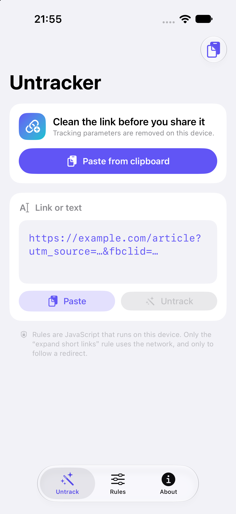

# Untracker for iOS

Remove tracking information from links before you share them — an iOS port of
[zhanghai/Untracker](https://github.com/zhanghai/Untracker) (Android).

Runs the **same JavaScript rules** as the Android app in JavaScriptCore, with the
rule set taken verbatim from upstream (Apache-2.0).

<p align="center">
  
</p>

## Why another link cleaner

Most clean-link tools delete a fixed blacklist of `utm_*` / `fbclid` / `gclid`.
Untracker instead runs **per-site rules** that know what each site actually needs:

- Bilibili keeps `p` / `t`, drops `spm_id_from` / `vd_source`
- YouTube keeps `v` / `t` / `list` / `index`
- Amazon also strips `/ref=…` out of the path
- Google Search keeps only `q` / `tbm`

and it can **expand short links** (`b23.tv`, `t.cn`, `amzn.to`, `xhslink.com`, …)
by following one redirect before cleaning.\n\n## Features

- **Share Extension** — appear in the share sheet's app row: share a link from any
  app, get it cleaned, then **Copy** or **Share again** (both actions mirror the
  Android app).
- **Action Extension** — the same UI in the share sheet's **Actions** row, and in
  Safari's action menu for the current page or a text selection (the closest iOS
  equivalent of Android's “select text → Untrack”).
- **Home screen quick actions** — long-press the app icon: *Paste & Untrack*, *Rules*.
- **Rule editor** — see which rule removed what, enable/disable the 27 built-in
  rules, write your own JS rule with syntax checking and a live preview.
- Everything is on-device. Only the short-link rule touches the network, and only
  to follow a redirect.

## Architecture

```
Sources/
  Kit/                    # shared by the app and both extensions
    UntrackURL.swift      # Uri-compatible URL model (keeps raw percent-encoding)
    UntrackBuiltins.swift # Swift implementation of the JS `$` API
    UntrackEngine.swift   # JavaScriptCore host + `$` shim + native bridge
    UntrackFetch.swift    # synchronous $.fetch for short-link expansion
    UntrackService.swift  # find links in text, run rules, splice back
    AutolinkWebURL.swift  # GENERATED: androidx AUTOLINK_WEB_URL as an ICU regex
    Rules.swift           # rule model, persistence (App Group + Keychain)
    SelfTest.swift        # on-device acceptance suite
  App/                    # SwiftUI: Untrack / Rules / About
  ExtensionKit/           # SwiftUI sheet shared by both extensions
  ShareExtension/         # com.apple.share-services entry point
  ActionExtension/        # com.apple.ui-services entry point
Resources/
  BuiltinRules.json       # 27 upstream rules, byte-identical to BuiltinRuleList.kt
  SelfTestCases.json      # 78 end-to-end cases
  FindURLsCases.json      # 60 link-detection span cases
tools/                    # build / sign / install / simulator scripts + oracles
docs/ENGINE-SEMANTICS.md  # exact JS `$` API and link-detection semantics
```

Three design points worth knowing:

1. **Rule semantics match upstream exactly.** `$.matches` is a *whole-string* match,
   a query pattern is skipped when the URL has no query, `remove/retainQueryParameters`
   go through `encode(decode(x))`, and only `getQueryParameter` treats `+` as a space.
   The 78-case suite pins this down.
2. **Link detection is not `NSDataDetector`.** It normalises URLs (for example it
   drops a trailing bare `?`) and disagrees with upstream on trailing punctuation,
   so `tools/gen-autolink.py` generates the real `androidx PatternsCompat.AUTOLINK_WEB_URL`
   pattern for ICU instead.
3. **Rule storage is cross-process.** The app and the extensions are separate
   sandboxes: an App Group container is used when available, with a shared Keychain
   group as fallback. Extensions always carry the built-in rules, so they work even
   if sharing is unavailable.

## Building

Requirements: macOS with Xcode 16+ (tested on Xcode 27.1 / iOS 27 SDK),
[XcodeGen](https://github.com/yonaskolb/XcodeGen) (`brew install xcodegen`).

```bash
bash tools/build.sh      # unsigned device IPA -> build/Unsigned.ipa
bash tools/sim.sh        # build + install + launch in the simulator
```

To run it on a physical iPhone you need your own Apple Distribution (Ad Hoc)
certificate and a provisioning profile that lists your device. The scripts take
everything from the environment, nothing is hard-coded:

```bash
export UNTRACKER_SIGN_IDENTITY="Apple Distribution: Your Name (TEAMID1234)"
export UNTRACKER_PROFILE=~/signing/profile.mobileprovision
export UNTRACKER_BASE_ENTITLEMENTS=~/signing/entitlements.plist
export UNTRACKER_APP_GROUP=group.example.shared        # must be in the profile
export UNTRACKER_KEYCHAIN_GROUP=TEAMID1234.untracker   # must match the team prefix
bash tools/sign.sh build/Unsigned.ipa build/Untracker-signed.ipa

export UNTRACKER_UDID=$(xcrun devicectl list devices | ...)
export UNTRACKER_APP_GROUP=group.example.shared
bash tools/device.sh install build/Untracker-signed.ipa
bash tools/device.sh launch
```

The App Group and Keychain group identifiers also appear in
`Sources/Kit/Rules.swift` and in the three `*.entitlements` files — change them
there if you sign with your own team.

## Verification

Everything here is reproducible; no debugger needed (an Ad Hoc install has
`get-task-allow=false`, so `SelfTest` writes its report into the app container).

| What | Result | How |
| --- | --- | --- |
| Rule data vs upstream | 27 rules, scripts byte-identical | `node tools/rules/verify-rules.mjs --src <path>/BuiltinRuleList.kt` |
| End-to-end cleaning | **78/78 cases** (simulator + device) | launch with `--run-selftest`, pull the JSON report |
| Link-detection spans | **60/60 cases, 52 spans identical** | `node tools/rules/verify-findurls.mjs --actual <export>` |
| Share/Action extension registration | both listed by `pluginkit` | `xcrun simctl spawn booted pluginkit -m -p com.apple.share-services` |

The span oracle was produced by running the real androidx matcher plus
`java.net.URI.normalize()` on a JVM — it is not a reimplementation of my own code.

## Differences from the Android app

1. Trailing punctuation stays inside the URL because that is what upstream's regex
   does (`.`, `)`, `,` at end of input). Deliberate: matching upstream beats
   inventing a second behaviour.
2. Upstream crashes (NPE) when a rule returns a non-absolute URL; this port ignores
   that rule result and keeps the previous URL instead.
3. There is no text-selection toolbar on iOS, so “select text → Untrack” becomes the
   Action Extension (Safari action menu) and paste-inside-the-app.
4. The two rules upstream ships disabled (Bilibili BV, Old Reddit) are also disabled
   by default here, but can be switched on.

## License

Apache License 2.0 — see [LICENSE](LICENSE) and [NOTICE](NOTICE).

Built-in rules and the rule-engine semantics come from
[zhanghai/Untracker](https://github.com/zhanghai/Untracker), Copyright 2023 Google LLC,
Apache-2.0. The link-detection pattern is derived from androidx.core's
`PatternsCompat` (Copyright The Android Open Source Project, Apache-2.0).
